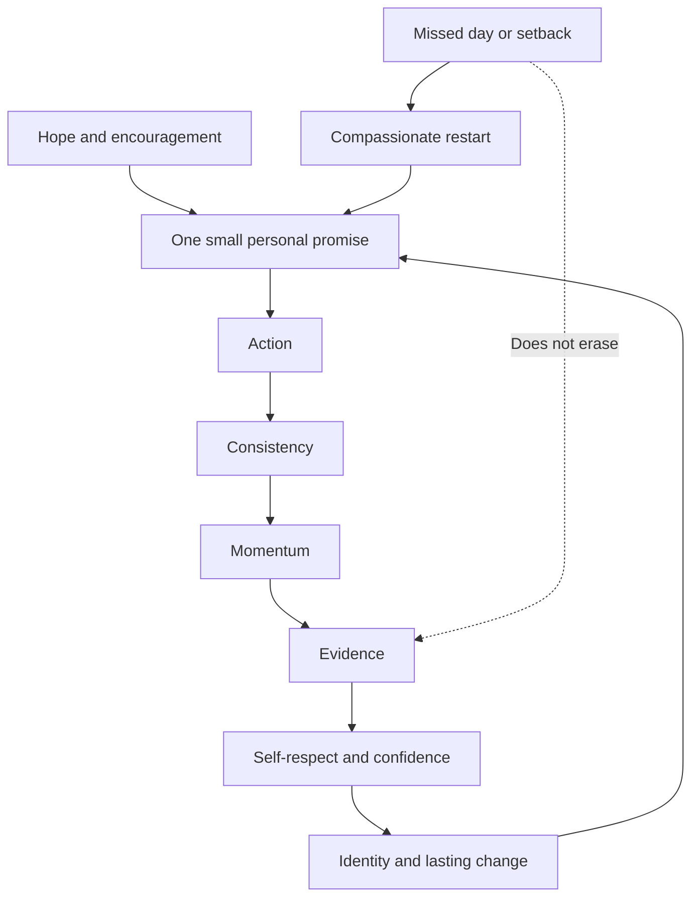
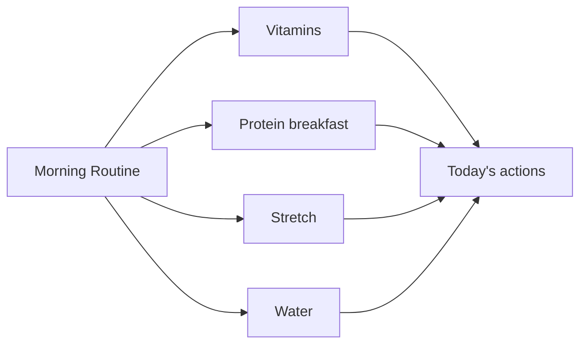
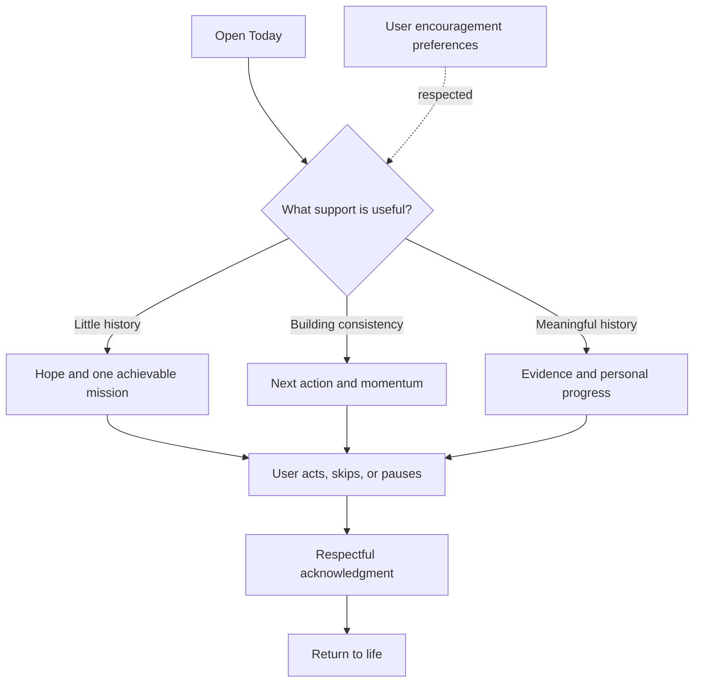
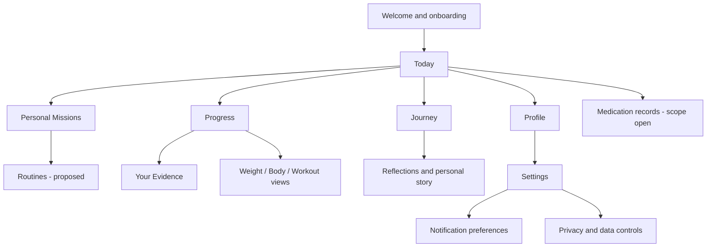
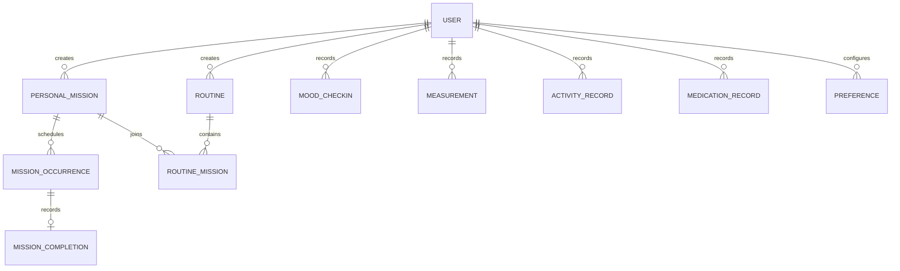
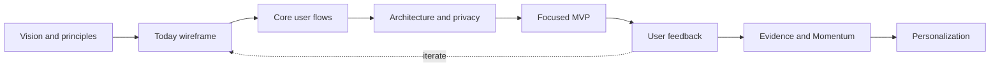

# Project 180: Personal Transformation Platform

**Current product plan** | November 20, 2026 | Working draft

> **Mission: Help people rebuild trust in themselves.**

> Small daily actions can change the direction of a life.

**Decision labels:** **Decided** = established direction; **Proposed** = promising idea; **Open** = requires design or validation.

---

## 1. Vision and positioning

Project 180 is a Personal Transformation Platform, not primarily a weight-loss, GLP-1, workout, calorie, or habit tracker. Those may be supporting features. The platform helps adults build healthier lives through meaningful, repeatable actions without pressure, shame, or competition.

The name has two meanings for its founder: a personal target of 180 pounds, and a 180-degree change in life's direction. For other users, it represents a positive change in direction, not a universal weight target.

**Audience (Decided):** Adults roughly 35–70, especially people tired of quick fixes, aggressive fitness culture, and overwhelming apps. They value calm, clarity, consistency, and personal autonomy.

**Product promise:** Help people quietly become someone they're proud of, one manageable promise at a time.

## 2. Transformation philosophy

Inspired by the broad small-improvements and identity-based change ideas explored in *Atomic Habits*, but expressed in Project 180's own original language. The app must not imitate the book's branding or copy its prose.



This is a design model, not a scientifically validated fixed sequence. People move between stages, and motivation can remain helpful throughout.

**Daily guiding question:** *What is one promise I can keep to myself today?*

## 3. Non-negotiable product principles

1. **Transformation over tracking:** Features exist to support life change, not logging for its own sake.
2. **Consistency over perfection:** A missed day does not invalidate previous effort.
3. **Momentum over streaks:** No punitive resets to zero.
4. **Evidence over votes:** No points, elections, leaderboards, rankings, XP, or winner/loser framing.
5. **Motivation matters:** Encourage users, especially before they have a history of accomplishments.
6. **Self-respect without shame:** No guilt, scolding, or manipulative messaging.
7. **Every number needs meaning:** Show context and explain why a metric matters.
8. **Calm wins:** Clean, modern, adult-oriented, Apple-like restraint.
9. **Helpful, not in your face:** Notifications are optional and respectful.
10. **The app serves the user:** No engagement traps or unnecessary screen time.
11. **One purpose per screen:** Reduce decision fatigue.
12. **Privacy is sacred:** Minimize sensitive data collection; design control, export, and deletion.
13. **Progress is personal:** Compare with one's own history, not other users.
14. **The app should disappear:** Get the user back to living their life.

## 4. Vocabulary and tone

| Use               | Avoid as primary framing | Purpose                        |
|-------------------|--------------------------|--------------------------------|
| Today             | Dashboard                | Immediate focus                |
| Personal Missions | Goals / chores           | Self-chosen commitments        |
| Momentum          | Streak                   | Sustainable forward movement   |
| Evidence          | Votes / points           | Real records of follow-through |
| Journey           | Competition              | Personal long-term growth      |
| Reflection        | Generic quote            | Perspective and encouragement  |
| Progress          | Score                    | Meaningful change              |
| Promise kept      | XP / winning             | Quiet acknowledgment           |

The voice is calm, encouraging, grounded, kind, professional, and never childish. No shouting, guilt, forced excitement, or false promises. Language should sound human and respect difficult days.

## 5. Core user experience: Today

**Decided:** The main screen is Today, not Dashboard. It should answer: *What matters today? What can I do now? Am I moving forward? How do I feel?*

**Proposed** low-fidelity sketch:

```text
TODAY
Good morning

Daily Reflection
"Small actions become extraordinary lives."

Today's Missions
[ ] Take vitamins
[ ] Walk for 20 minutes
[ ] Drink water

Momentum
A calm summary of recent consistency

How are you feeling?
[Great] [Good] [Okay] [Tough Day]

Today | Journey | Progress | Profile
```

**First-day requirement:** The screen must work with zero history. It should offer hope, a manageable next action, and no empty graphs that imply failure.

**Decided:** On day one, the Momentum section is hidden and replaced with encouragement until there is enough history to describe.

**One Thumb Test (Proposed acceptance target):** A user should be able to check missions, record a quick item (such as weight or vitamins), and close the app in approximately 30 seconds. This is a target to validate with testing.

## 6. Personal Missions

**Decided:** Users choose their own meaningful commitments. Examples: walk Monday/Wednesday/Friday, take vitamins, stretch after dinner, read, practice golf, log water, or follow a prescribed medication schedule.

**Proposed fields:** Title, optional description, category, schedule, reminder preference, active/paused state, and completion history. Users must be able to edit, pause, skip, and restart missions without being punished.

**Decided:** Deferring a mission means **moving it to tomorrow**. See [Wireframes.md](Wireframes.md) §3 for proposed rules.

**Proposed:** The day follows the phone's time zone automatically (no time zone setting), with an optional "My day ends at" setting (default 3:00 AM). See [Wireframes.md](Wireframes.md) §2.

### Routines (Proposed)

Group related missions into Morning, Evening, Gym, or other routines to reduce friction.



## 7. Daily Reflections and mood

**Daily Reflections (Decided):** One short, original reflection that provides perspective rather than manufactured enthusiasm. Examples of intended tone:

- "Small actions become extraordinary lives."
- "Progress is rarely dramatic while it's happening."
- "One difficult day doesn't erase the work you've done."
- "You can begin with something small."

**Mood (Proposed):** Optional one-tap check-in: Great / Good / Okay / Tough Day. Future pattern summaries must avoid unsupported causal claims or diagnoses. Skipping is always allowed.

## 8. Momentum, not streaks

**Decided:** Momentum should build and decline gradually, without erasing history after a missed day. Rest days, travel, illness, and paused missions must be treated thoughtfully.

**Open:** Whether to represent momentum with a narrative, trend, visualization, or explainable numeric calculation; what time window to use; and how missed versus non-scheduled days are handled.

**Implementation rule:** Do not invent a momentum score until the calculation and edge cases have been designed and tested. Never present an opaque score as a measure of personal worth.

## 9. Evidence, not votes

**Decided:** Votes were rejected because they suggest competition and meaningless scorekeeping. Evidence means understandable, verifiable records of actions and changes that help a user see what they've built.

Illustrative examples, not actual user data:

- 43 workouts completed in the last three months.
- 18 walks recorded this month.
- Morning routine completed on 21 of 30 eligible days.
- Personal weight or strength trend over time.

**Evidence rules:**

- Derive evidence from real recorded events, not a manually incremented point total.
- Include time frames and denominators when relevant.
- Show personal progress, not comparisons with others.
- Distinguish completing a log entry from achieving a health outcome.
- Don't assume more medication, exercise, or restriction is always better.
- Preserve accomplishments through setbacks.
- Never equate numbers with the person's value.

**Proposed:** *Your Evidence* as a section within Progress rather than necessarily its own navigation tab.

## 10. Motivation evolves with the person

**Decided:** Motivation is an important secondary objective, particularly at the beginning when there is little evidence. The app should evolve in tone as users develop history, but never assume someone no longer needs encouragement.

| Experience  | User need   | App role  | Emphasis                             |
|-------------|-------------|-----------|--------------------------------------|
| Starting    | Hope        | Guide     | Encouragement and one small action   |
| Building    | Consistency | Coach     | Practical support and momentum       |
| Established | Recognition | Companion | Evidence and perspective             |
| Long-term   | Autonomy    | Mirror    | Quiet reflection and personal growth |

These are experience patterns, not mandatory timelines. Users should control how much encouragement they receive.



## 11. Notifications and reminders

**Decided:** Notifications are optional, never required for core app use, and must not nag.

**Proposed choices:** Never / Gentle / Scheduled / Only if I miss it.

**Open:** Exact definitions, permission flow, quiet hours, missed-event detection, and limits on reminder frequency. No guilt, artificial urgency, or repeated re-engagement pressure.

## 12. Potential health and lifestyle modules

Project 180 may support weight history, body measurements, workouts, nutrition/protein missions, medication schedules, activity, mood, and reflections. The precise MVP feature set is **Open**. The app should not become a medical decision-maker: medication records organize user information, not prescribe doses or recommend treatment changes.

## 13. Screen inventory and information architecture

**Decided:** Start with low-fidelity wireframes, one page per screen, before building in Cursor. No Figma requirement initially.

**Proposed inventory** (approximately 12 screens): Welcome, Splash, Today, Journey, Weight, Medication, Body Progress, Workout Progress, Personal Missions, Progress/Evidence, Profile, Settings. Routines may become an additional flow.



Navigation, onboarding questions, and which screens deserve top-level placement remain **Open**.

**Decided:** Medication is left out of the first round of wireframes until its scope (§12) is resolved.

## 14. Conceptual data model

Not a finalized database schema. Evidence should be derived from history, not stored as an arbitrary score.



**Design considerations:** Preserve historical completions when schedules change; handle time zones and rest days; distinguish scheduled, skipped, paused, and completed events; plan secure storage, consent, export, deletion, and data minimization before collecting sensitive information.

## 15. Proposed development roadmap

| Phase              | Objective                   | Deliverables                                                    |
|--------------------|-----------------------------|-----------------------------------------------------------------|
| 0. Foundation      | Agree on identity           | Vision, principles, brand, manifesto draft                      |
| 1. UX              | Validate daily experience   | Today wireframe, mission flows, onboarding, navigation          |
| 2. Architecture    | Choose safe implementation  | Platform, data model, privacy, sync, security                   |
| 3. Focused MVP     | Deliver useful daily action | Today, Missions, history, Reflections, basic Progress, Settings |
| 4. Progress        | Make change visible         | Evidence, explainable Momentum, selected health modules         |
| 5. Personalization | Match user preferences      | Routines, encouragement settings, nuanced reminders             |
| 6. Refinement      | Improve real-world use      | Accessibility, performance, testing, feedback                   |

**Proposed MVP boundary:** Prove that Today + Missions + Reflection + Progress are useful before implementing every possible health module.



## 16. Success criteria

Avoid optimizing primarily for time-in-app or notification opens. Success means users can find a manageable action, record it quickly, understand their progress, recover from missed days, and trust their data.

**Proposed measures to define after testing:** Mission setup completion; time to log a mission; user-reported clarity, autonomy, and encouragement; accuracy of Evidence summaries; voluntary sustained usefulness. No fabricated targets or untested outcome claims.

## 17. Open product decisions

1. Final Today layout and navigation.
2. First-run experience with zero history.
3. Mission scheduling, editing, pausing, and missed-day handling.
4. Explainable Momentum presentation and calculation.
5. MVP health modules versus later releases.
6. Encouragement personalization and notification behavior.
7. Platform, tech stack, authentication, offline operation, and sync.
8. Privacy, accessibility, export, deletion, and retention requirements.
9. Reflection content creation and review process.
10. Usability testing with representative adults in the target audience.

## 18. Working project documents

- `Vision.md`: Mission, positioning, audience, scope.
- `Product_Principles.md`: Product rules and guardrails.
- `Brand.md`: Voice, language, visual direction.
- `Manifesto.md`: Philosophy and emotional promise, to develop thoughtfully.
- `Wireframes.md`: Screen-by-screen designs.
- `Roadmap.md`: MVP scope and milestones.
- `Database.md`: Technical schema after UX requirements are resolved.
- `Project180_Current_Plan.md`: This consolidated reference.

## 19. Immediate next step

Design the Today screen before writing application code. Review its experience on day one, day 30, and day 180. Test how a user completes, skips, or defers a mission, sees encouragement without pressure, and finishes common actions in roughly 30 seconds.

---

> **North star:** Project 180 helps people make small promises, keep them when they can, recover when they can't, and recognize the person they're becoming.
