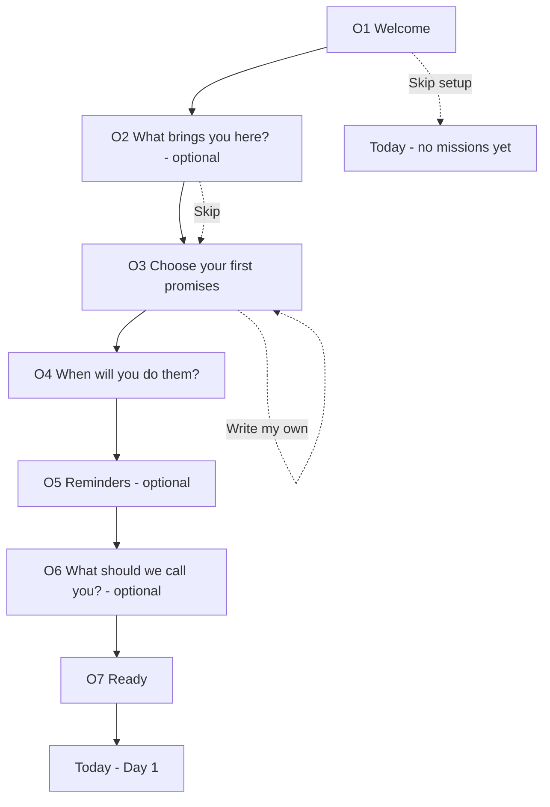

# Project 180 — Wireframes

**Working draft** | November 20, 2026 | Low fidelity, one screen per section

Scope of this draft: the **Today** screen across a user's journey (day 1, day 30, day 180), the core mission actions (**complete, skip, move to tomorrow**), and **Onboarding** (§11).

Decision labels: **Decided** / **Proposed** / **Open**, as in [Project180_Current_Plan.md](Project180_Current_Plan.md).

Wireframes are text sketches. They show content, order, and priority, not visual design. Example missions and numbers are illustrative, not real data.

---

## 1. Ground rules for these wireframes

These come from the plan's principles and apply to every sketch below.

- **One purpose:** Today answers *What matters today? What can I do now? Am I moving forward? How do I feel?* Nothing else.
- **No failure visuals:** no red, no ✗ marks, no empty charts, no "0%".
- **Every number has a time frame and a denominator.**
- **Everything is optional** except seeing the screen. Mood, reflection, and reminders can all be ignored.
- **Finishing is the goal.** When everything is handled, the screen says so and lets the user go.

## 2. Defining "a day"

| Rule | Status |
|------|--------|
| The day uses the phone's current time zone automatically. No time zone setting. | **Proposed** |
| When travelling, a mission belongs to the calendar day where the user is. A day is never counted twice or lost from history. | **Proposed** |
| Optional setting **"My day ends at"**, default 3:00 AM, in Settings. A 12:30 AM walk counts for the previous day. | **Proposed** |
| Scheduled times (e.g., "morning") follow local time. 8:00 AM vitamins stay 8:00 AM after flying. | **Proposed** |

## 3. Mission occurrence states

Each scheduled mission on a given day is an **occurrence**. These states drive Today, Momentum, and Evidence.

| State | How it happens | What the user sees | Counts toward Evidence denominators? |
|-------|----------------|--------------------|--------------------------------------|
| Scheduled | Default for a planned day | Empty circle | Yes, once the day ends |
| Completed | User taps it | Filled circle, quiet "Done" | Yes, as kept |
| Skipped | User chooses **Not today** | Soft gray "Skipped", no judgment | Yes, shown separately as "skipped" (§9) |
| Moved to tomorrow | User chooses **Move to tomorrow** | Disappears today, appears tomorrow labeled "from yesterday" | Counts once, on the new day |
| Paused | Mission paused in Missions | Not shown on Today | No |
| Not recorded | Day ends with no action | Never called "missed" or "failed" in the UI | Yes (§9) |

**Decided:** "Move to tomorrow" means the occurrence moves to the next day.

**Proposed rules for moving to tomorrow:**

- If the mission is **already scheduled tomorrow** (e.g., a daily mission), "Move to tomorrow" is replaced by **Not today**, so tomorrow never shows the same mission twice.
- A moved occurrence can be moved again. No limit and no penalty. History stores the original date for honest Evidence.
- Moving is never shown as a negative in Momentum.

---

## 4. Today — anatomy

Top to bottom, in priority order. Sections hide when they have nothing useful to say.

| # | Section | Purpose | Shown when |
|---|---------|---------|------------|
| 1 | Greeting + date | Orientation | Always |
| 2 | Daily Reflection | Perspective, one line | Always (user can turn off) |
| 3 | Today's Missions | What can I do now? | Always, the core of the screen |
| 4 | Yesterday check-in | Catch actions done but not logged | Only if yesterday has unrecorded missions (see §8.4) |
| 5 | Momentum | Am I moving forward? | **Only once there is enough history** (see §5) |
| 6 | How are you feeling? | Optional mood | Until answered today |
| — | Tab bar | Today · Journey · Progress · Profile | Always |

---

## 5. Today — Day 1

The user has just finished onboarding and chosen two missions. They have no history at all.

```text
┌─────────────────────────────────────┐
│  Good morning, Sam                  │
│  Thursday, November 20              │
│                                     │
│  ─────────────────────────────────  │
│  "You can begin with something      │
│   small."                           │
│  ─────────────────────────────────  │
│                                     │
│  YOUR FIRST PROMISES                │
│                                     │
│  ○  Take vitamins                   │
│  ○  Walk for 10 minutes             │
│                                     │
│  Keeping one of these today is a    │
│  real start.                        │
│                                     │
│  ─────────────────────────────────  │
│  How are you feeling?               │
│  [Great] [Good] [Okay] [Tough day]  │
│                          Skip       │
│                                     │
├─────────────────────────────────────┤
│  Today   Journey   Progress  Profile│
└─────────────────────────────────────┘
```

**Design notes**

- **No Momentum section.** Its space is replaced by one line of encouragement under the missions. (Agreed: no empty graphs on day one.)
- Section title is **"Your first promises"** instead of "Today's Missions", for the user's first 5 days. **Decided** (4–5 days discussed; 5 chosen, easy to adjust after testing)
- Encouragement says *one* is enough. It lowers the bar on purpose.
- Onboarding should suggest starting with **1–3 missions**. More than that on day one is allowed but gently questioned. **Proposed**

**After the first completion (Day 1):**

```text
│  ●  Take vitamins            Done   │
│  ○  Walk for 10 minutes             │
│                                     │
│  That's your first promise kept.    │
```

A single quiet sentence. No confetti, sound, or badge.

---

## 6. Today — Day 30

The user has 4 missions and a month of real history, including some skipped and unrecorded days.

```text
┌─────────────────────────────────────┐
│  Good morning, Sam                  │
│  Saturday, December 20              │
│                                     │
│  ─────────────────────────────────  │
│  "Progress is rarely dramatic while │
│   it's happening."                  │
│  ─────────────────────────────────  │
│                                     │
│  TODAY'S MISSIONS            2 of 4 │
│                                     │
│  MORNING                            │
│  ●  Take vitamins            Done   │
│  ●  Protein breakfast        Done   │
│                                     │
│  LATER                              │
│  ○  Walk for 20 minutes             │
│     from yesterday                  │
│  ○  Stretch after dinner            │
│                                     │
│  ─────────────────────────────────  │
│  MOMENTUM                           │
│  Building steadily.                 │
│  You walked on 9 of 12 planned days │
│  in the last 4 weeks.            ›  │
│  ─────────────────────────────────  │
│                                     │
│  How are you feeling?               │
│  [Great] [Good] [Okay] [Tough day]  │
│                                     │
├─────────────────────────────────────┤
│  Today   Journey   Progress  Profile│
└─────────────────────────────────────┘
```

**Design notes**

- Missions are grouped by time of day once there are enough to need it. This is a light version of Routines. **Proposed**
- "2 of 4" is the only count on Today. It's a status, not a grade.
- **Momentum is a short sentence, not a score.** The wording uses a recent, real fact with a time frame. The calculation is still **Open** (plan §8). This placeholder only uses plain counts. Tapping › opens Progress.
- "from yesterday" marks a moved mission without judgment.

---

## 7. Today — Day 180

Established user. The app moves from Coach toward Companion/Mirror (plan §10). The screen gets *quieter*, not busier.

```text
┌─────────────────────────────────────┐
│  Good evening, Sam                  │
│  Tuesday, May 19                    │
│                                     │
│  "One difficult day doesn't erase   │
│   the work you've done."            │
│                                     │
│  TODAY                       3 of 3 │
│                                     │
│  ●  Morning routine (4)      Done   │
│  ●  Walk for 30 minutes      Done   │
│  ●  Read 10 pages            Done   │
│                                     │
│  Everything's handled for today.    │
│                                     │
│  ─────────────────────────────────  │
│  SIX MONTHS IN                      │
│  128 walks since November.          │
│  That's who you've become.       ›  │
│  ─────────────────────────────────  │
│                                     │
├─────────────────────────────────────┤
│  Today   Journey   Progress  Profile│
└─────────────────────────────────────┘
```

**Design notes**

- A whole routine collapses to one row. Tapping it expands its 4 missions. **Proposed**
- **"Everything's handled for today."** is the exit signal: the app is done and the user can leave (Principle 14).
- Momentum is replaced by **Evidence** at milestones (e.g., 30, 90, 180 days, 1 year). The milestone wording points to identity ("who you've become") without inflating it. **Proposed**
- Mood was already answered today, so it's hidden.
- Encouragement still appears in the Reflection. The app doesn't assume the user no longer needs it. Users control the amount in Settings.

---

## 8. Core flows

### 8.1 Complete a mission — 1 tap

```text
○  Walk for 20 minutes      →  tap  →   ●  Walk for 20 minutes   Done
                                         Undo (visible for 5 seconds)
```

- One tap anywhere on the row. No confirmation dialog.
- Light haptic tick. No sound by default.
- **Undo** stays visible for a few seconds. After that, the user can still uncheck it by tapping again.
- If the mission tracks a value (e.g., weight, minutes), the tap opens a **one-field sheet** with the last value pre-filled and a large **Save** button. **Proposed**

### 8.2 Skip or move a mission — swipe or long-press

```text
○  Walk for 20 minutes      →  swipe left / long-press  →

   ┌───────────────────────────────┐
   │  Walk for 20 minutes          │
   │                               │
   │  [ Move to tomorrow ]         │
   │  [ Not today        ]         │
   │                               │
   │  Pause this mission…          │
   │  Cancel                       │
   └───────────────────────────────┘
```

- **Move to tomorrow** → the row slides away with the message *"Moved to tomorrow."* Tomorrow it appears with "from yesterday". Not offered when the mission is already scheduled tomorrow (§3).
- **Not today** → the row stays, grayed: *"Skipped. That's okay."* Tap again to restore it.
  Below it, an optional one-tap reason appears for a few seconds, then fades if ignored:

  ```text
  ◌  Walk for 20 minutes     Skipped. That's okay.
     Why? (optional)  [Rest] [Sick] [Traveling] [Other]
  ```
- **Pause this mission…** → goes to the mission's settings. Handy during illness or travel.
- **Decided:** A skip reason is offered but never required. Reasons give Evidence context (e.g., "2 skipped: 1 sick, 1 traveling") and are never used to judge. Reasons are private user data, covered by export and deletion.

### 8.3 Mood check-in — 1 tap, optional

- Tapping a mood records it and collapses the section to *"Thanks for checking in."*
- **Tough day** gets one extra line: *"Thanks for being honest. Today, one small thing is plenty."* The app never suggests doing *more*.
- **Skip** hides the section for today.

### 8.4 Yesterday check-in — Proposed

Many adults do the thing and forget to log it. The first time the app is opened on a new day, any of yesterday's unrecorded missions are offered once:

```text
│  YESTERDAY                          │
│  Did any of these happen?           │
│  ○  Stretch after dinner            │
│  ○  Read 10 pages                   │
│              Yes, mark done · No    │
```

- "No" (or simply ignoring it) leaves them as *not recorded*. They're never labeled missed.
- Only yesterday, and only once. No backlog of guilt.

### 8.5 One Thumb Test — target ≈ 30 seconds

Scenario: a Day 30 morning. Log vitamins and weight, check mood, close.

| Step | Action | Est. time |
|------|--------|-----------|
| 1 | Open app (lands on Today) | 2 s |
| 2 | Tap *Take vitamins* | 1 s |
| 3 | Tap *Log weight* → value pre-filled → adjust → Save | 8 s |
| 4 | Tap mood *Good* | 1 s |
| 5 | Close app | 1 s |
| | **Total** | **≈ 13 s** |

Estimates only. They need to be checked by testing with real users in the target age range. Everything happens in the thumb zone. No step needs a second screen except the one-field value sheet.

---

## 9. Edge cases

| Situation | Today shows | Status |
|-----------|-------------|--------|
| No missions scheduled today (rest day) | Reflection + *"Nothing planned today. Rest counts too."* | Proposed |
| All missions done | *"Everything's handled for today."* | Proposed |
| Returning after 10+ days away | *"Welcome back. Your history is still here. Start with one thing today."* No list of what was missed. Offer to pause or simplify missions. | Proposed |
| Mission created mid-day | Appears today only if the user chooses "Start today". Otherwise it starts tomorrow. | Proposed |
| Schedule changed | Past occurrences keep their original schedule. Changes apply from today forward. | Decided (plan §14) |
| Do skipped days count in Evidence denominators? | Yes. Shown honestly and separately: "9 of 12 planned days, 2 skipped" | **Decided** |
| Do unrecorded days count as "planned" in Evidence? | Yes, they count as planned. Wording stays neutral ("9 of 12 planned days"), never "3 missed" | **Decided** |

---

## 10. Open questions from this draft

1. Momentum wording rules and thresholds for "Building steadily" etc. These depend on the Momentum design (plan §8).
2. Milestone days for Evidence callouts on Today.
3. Time-of-day grouping: automatic from reminder times, or user-assigned?

Resolved November 20, 2026: skipped and unrecorded days both count in Evidence denominators, with skips shown separately; optional one-tap skip reasons; *Your first promises* shows for the first 5 days.

## 11. Onboarding — zero history to first promises

**Goal:** Get a brand-new user from opening the app to a Day 1 Today screen with 1–3 small missions, feeling hopeful rather than assessed.

**Targets (Proposed, to validate in testing):** about 1–2 minutes in total, with a shortest path of about 5 taps. Every question except choosing one mission can be skipped.

### 11.1 Flow



### 11.2 What onboarding does not ask

**Proposed.** Each item is left out on purpose (Principles 6 and 12). Users can add any of them later, inside the relevant feature, when they choose to.

- No weight, goal weight, BMI, or body photos.
- No age, sex, health conditions, or medications.
- No "how motivated are you?" or self-assessment scores.
- No contacts, social sign-in prompts, or invitations to friends.
- The number 180 is never presented as a target weight.

### O1 — Welcome

```text
┌─────────────────────────────────────┐
│                                     │
│              Project 180            │
│                                     │
│   Small daily actions can change    │
│   the direction of a life.          │
│                                     │
│   Start with one promise you can    │
│   keep. We'll help with the rest.   │
│                                     │
│                                     │
│         [      Begin      ]         │
│                                     │
│     I already use Project 180       │
└─────────────────────────────────────┘
```

- No account wall before value. When and whether an account is needed depends on the platform and sync decisions (plan §17.7). **Open**
- "I already use Project 180" leads to sign-in or restoring data. **Open**

### O2 — What brings you here? (optional)

```text
┌─────────────────────────────────────┐
│  ‹                            Skip  │
│                                     │
│  What would you like more of?       │
│  Choose any. This only shapes       │
│  suggestions.                       │
│                                     │
│  [ Energy        ]  [ Movement    ] │
│  [ Better eating ]  [ Calm        ] │
│  [ Strength      ]  [ Routine     ] │
│  [ Healthier weight ]               │
│  [ Just looking around ]            │
│                                     │
│         [    Continue    ]          │
└─────────────────────────────────────┘
```

- The wording is "more of," not "what's wrong." It's about direction, not a diagnosis.
- Choices are used only to order the suggestions in O3. They're stored as a preference the user can change or delete. **Proposed**
- Skipping shows a balanced general list in O3.

### O3 — Choose your first promises

```text
┌─────────────────────────────────────┐
│  ‹                                  │
│                                     │
│  Pick one to three small promises.  │
│  Small enough to keep on a hard day.│
│                                     │
│  SUGGESTED FOR YOU                  │
│  ○  Walk for 10 minutes             │
│  ○  Drink a glass of water at       │
│     breakfast                       │
│  ○  Take vitamins                   │
│  ○  Stretch for 5 minutes           │
│  ○  Protein with breakfast          │
│  ○  In bed by 10:30                 │
│                     Show more ›     │
│                                     │
│  +  Write my own                    │
│                                     │
│         [ Continue (2) ]            │
└─────────────────────────────────────┘
```

- **Suggestions are deliberately small** ("10 minutes," not "an hour"). Users can edit the wording or amount of any suggestion before continuing.
- **Picking a 4th or more** is allowed, and shows a calm note instead of a block: *"You can always add more later. Starting small makes the first week easier to keep."* **Proposed**
- **Write my own** opens a single text field. Category is optional and can be guessed later.
- Suggestion text follows the Brand voice and is reviewed like Reflections (plan §17.9). **Open**

### O4 — When will you do them?

One compact card per chosen mission, with sensible defaults already filled in so the user can just tap Continue.

```text
┌─────────────────────────────────────┐
│  ‹                                  │
│  When works for you?                │
│  You can change this anytime.       │
│                                     │
│  Walk for 10 minutes                │
│  Days   (Every day) Weekdays  Pick… │
│  Time   Morning (Afternoon) Evening │
│         Anytime                     │
│  ─────────────────────────────────  │
│  Take vitamins                      │
│  Days   (Every day) Weekdays  Pick… │
│  Time   (Morning) Afternoon Evening │
│         Anytime                     │
│                                     │
│         [    Continue    ]          │
└─────────────────────────────────────┘
```

- Time of day here feeds the Morning / Later grouping on Today (§6), which partly answers Open question 3 in §10.
- Exact clock times are optional and live in mission settings, not onboarding.

### O5 — Reminders (optional)

```text
┌─────────────────────────────────────┐
│  ‹                                  │
│  Would reminders help?              │
│  Project 180 works fine without     │
│  them.                              │
│                                     │
│  ( ) Not now                        │
│  ( ) Gentle — one quiet nudge a day │
│  ( ) At the times I do things       │
│  ( ) Only if I haven't checked in   │
│                                     │
│         [    Continue    ]          │
└─────────────────────────────────────┘
```

- **Not now** is the first option and the default. **Proposed**
- The phone's notification-permission prompt appears **only** if the user picks a reminder option, and only after they press Continue.
- Labels map to plan §11 (Never / Gentle / Scheduled / Only if I miss it). The plan's "Only if I miss it" is reworded to avoid "miss." Exact behavior is still **Open**.

### O6 — What should we call you? (optional)

```text
┌─────────────────────────────────────┐
│  ‹                            Skip  │
│                                     │
│  What should we call you?           │
│  [ Sam                          ]   │
│                                     │
│  Just for greetings. A first name   │
│  or nickname is perfect.            │
│                                     │
│  ─────────────────────────────────  │
│  Your information belongs to you.   │
│  You can export or delete it at any │
│  time from Settings.                │
│                                     │
│         [    Continue    ]          │
└─────────────────────────────────────┘
```

- If skipped, the greeting is just "Good morning."
- The privacy line only promises what's already **Decided** (export and deletion). Claims about where data is stored wait for the architecture decisions.

### O7 — Ready

```text
┌─────────────────────────────────────┐
│                                     │
│   You've made two promises.         │
│                                     │
│   Keeping even one of them today    │
│   is a real start.                  │
│                                     │
│         [  Go to Today  ]           │
│                                     │
└─────────────────────────────────────┘
```

- **Late in the day** (proposed: after 6 PM local time), an extra choice appears: **Start today** / **Start tomorrow**. Starting tomorrow shows a Day 1 Today that says *"Your first promises begin tomorrow. Nothing to do tonight."*
- No tutorial carousel. Today itself teaches tap to complete, with a one-time hint: *"Tap a promise when it's done. Swipe for other options."* **Proposed**

### 11.3 Onboarding edge cases

| Situation | Behavior | Status |
|-----------|----------|--------|
| User skips setup from Welcome | Today shows the Reflection and one card: *"Add your first promise"* with 3 suggestions. No empty lists. | Proposed |
| User quits mid-onboarding | Choices so far are kept. Next open resumes at the same step, with **Skip setup** available. | Proposed |
| User picks 6+ missions | Allowed after the calm note in O3. | Proposed |
| User declines notification permission in the OS prompt | Setting falls back to **Not now**, with no repeated asking. Can be changed in Settings. | Proposed |

### 11.4 Open questions from onboarding

1. When an account is created, and whether the app works fully offline without one (plan §17.7).
2. Whether O2 earns its place, or whether suggestions alone are enough. A good candidate for usability testing.
3. Who writes and reviews the suggestion library, and how big it is at launch.
4. The cutoff time for offering **Start tomorrow** (6 PM proposed).

## 12. Next screens to draft

Personal Missions (create, edit, pause) · Progress / Your Evidence · Settings (encouragement level, notifications, "My day ends at", privacy).

Medication is deliberately left out of this round of wireframes until its scope is decided (plan §12).
